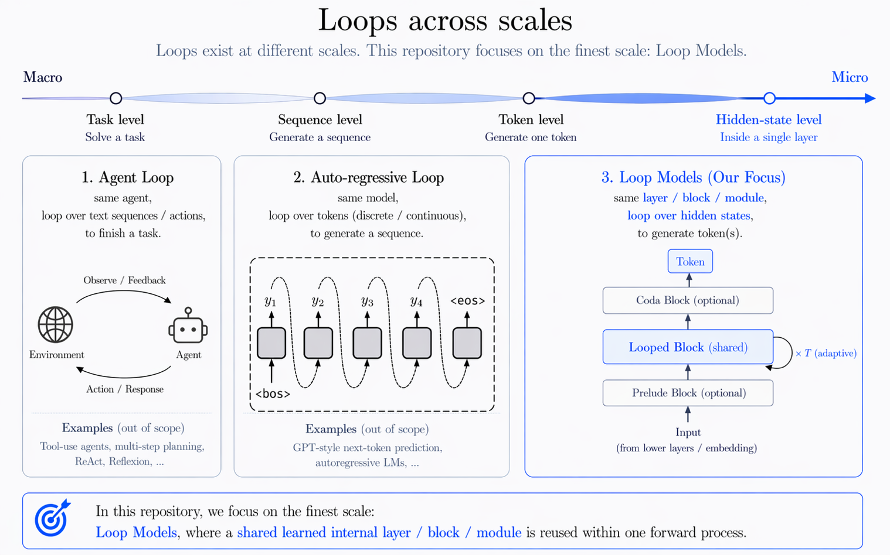

<div align="center">

# Awesome Loop Models

**Models that compute by looping: one learned layer, block, or operator, reused inside a single forward pass.**

[](https://awesome.re)
[](https://huskydoge.github.io/Awesome-Loop-Models/index.html)
[](https://huskydoge.github.io/Awesome-Loop-Models/submit.html)
[](https://opensource.org/licenses/MIT)


### 🌐 [**Interactive Browser**](https://huskydoge.github.io/Awesome-Loop-Models/index.html) · 🧾 [**PR Submission Guide**](https://huskydoge.github.io/Awesome-Loop-Models/submit.html)

<sub>The full catalog lives in the browser: search, browse by chapter, filter by section and loop design, and read TL;DRs, venues, code links, and daily briefings.</sub>

</div>

## News

- **2026-07-17** — The browser gained a **Release Intelligence** view: publication pulse, long-term trends, and dossiers for the latest releases. [Explore stats](https://huskydoge.github.io/Awesome-Loop-Models/index.html#stats)
- **2026-04-24** — Awesome Loop Models is released. [Announcement](https://x.com/huskydogewoof/status/2047655947942744285)

## What is a loop model?

> Within a single forward pass, a shared learned layer, block, module, or operator is reused.

That covers looped, recurrent-depth, and weight-tied Transformers, adaptive halting over a reused block, deep-equilibrium and implicit layers, and shared neural algorithmic processors, plus theory and analysis of all of these. It leaves out agent loops, repeated full-model calls, diffusion-style iterative inference, and plain recurrence over time steps. [TAXONOMY.md](TAXONOMY.md) has the full rules.

<details>
<summary>Where the scope boundary sits</summary>
<br>


Only the rightmost end of this scale is in scope. Omitting `catalog_fit` means strict scope; the rare exceptions kept for context set `catalog_fit: adjacent` and are labeled **Adjacent work**.
</details>

<details>
<summary>How the catalog is organized</summary>
<br>

The catalog is organized as a **topic map** of chapters and sections. Each paper lists every section it belongs to, primary first, and the browser files it under that primary section.

| Part | Chapters |
|:--|:--|
| I. Foundations | §2 From recurrent computation to iterative depth |
| II. What looping buys | §3 Capabilities, benefits and trade-offs |
| III. Building, training and deploying | §4 Architecture · §5 Learning algorithms · §6 Scaling laws · §7 Systems |
| IV. Understanding and applications | §8 Why looped models work · §9 Applications |
| V. Open problems | §10 Diffusion · folding depth into time · monitorability and safety |

Every paper also records its design axes (`loop_topology`, `sharing`, `depth_control`) and what it claims looping buys (`claims`, `comparison`). All values are controlled; there are no free-form tags. Blogs sit in one flat section and list only the sections they discuss. [TAXONOMY.md](TAXONOMY.md) explains each value and [TAGS.md](TAGS.md) shows current counts.
</details>

<!-- AUTO-GENERATED by scripts/build.py on 2026-10-21 10:27 UTC — DO NOT EDIT the sections below manually. Edit papers/*.yaml or blogs/*.yaml and run `python3 scripts/build.py` instead. -->

## At a glance

<p align="center"><b>346 papers</b> · 32 sections · <b>8 blogs</b> · <a href="https://huskydoge.github.io/Awesome-Loop-Models/index.html">browse all →</a></p>

## 🗺️ Topic map

The catalog is organized into chapters and sections. A paper is counted once under its primary section and again under every other section it belongs to.

<details>
<summary>Papers per section</summary>

| § | Section | Primary | Any |
|:--|:--|:--|:--|
| §2.1 | From Recurrent Computation to Iterative Depth › Recurrent networks and weight sharing across computation | 2 | 3 |
| §2.2 | From Recurrent Computation to Iterative Depth › Weight sharing across network depth | 4 | 6 |
| §2.3 | From Recurrent Computation to Iterative Depth › Deep equilibrium and implicit models | 7 | 11 |
| §2.4 | From Recurrent Computation to Iterative Depth › Iterative and algorithmic computation | 4 | 8 |
| §3.1 | Capabilities, Benefits and Trade-offs › Parameter, data, and compute efficiency | 7 | 42 |
| §3.2 | Capabilities, Benefits and Trade-offs › Expressivity and reasoning capacity | 19 | 23 |
| §3.3 | Capabilities, Benefits and Trade-offs › Length, easy-to-hard, and compositional generalization | 11 | 23 |
| §4.1 | Architecture and Design › Loop topology | 12 | 28 |
| §4.2 | Architecture and Design › Residual manipulation and initialization | 9 | 36 |
| §4.3 | Architecture and Design › Recurrent state and loop-time memory | 9 | 19 |
| §4.4 | Architecture and Design › Weight-sharing schemes and iteration-dependent computation | 6 | 27 |
| §4.5 | Architecture and Design › Controlling recurrence depth | 20 | 61 |
| §4.6 | Architecture and Design › Hybrid looped architectures | 18 | 25 |
| §5.1 | Learning Algorithms › Supervision, credit assignment, and loop-specific optimization | 24 | 69 |
| §5.2 | Learning Algorithms › Post-training and reinforcement learning | 7 | 14 |
| §5.3 | Learning Algorithms › Retrofitting pretrained models into looped models | 13 | 20 |
| §6.1 | Scaling Laws › Parameter, depth, and compute-optimal scaling | 8 | 18 |
| §6.2 | Scaling Laws › Test-time scaling | 12 | 48 |
| §7.1 | Systems and Infrastructure › Quantization and edge deployment | 10 | 14 |
| §7.2 | Systems and Infrastructure › KV cache and memory | 8 | 17 |
| §7.3 | Systems and Infrastructure › Loop-level batching, scheduling, and parallel execution | 6 | 9 |
| §8.1 | Understanding Why Looped Models Work › Why looped models work | 1 | 13 |
| §8.2 | Understanding Why Looped Models Work › Mechanistic interpretability | 22 | 34 |
| §8.3 | Understanding Why Looped Models Work › When looping does not help: limits and failure modes | 12 | 38 |
| §9.1 | Applications › Language, code, speech, and multimodal tasks | 25 | 33 |
| §9.2 | Applications › Visual recognition, restoration, and generation | 21 | 29 |
| §9.3 | Applications › Flow, stereo, and 3D geometry | 5 | 5 |
| §9.4 | Applications › Graphs, structured data, and scientific modeling | 19 | 29 |
| §9.5 | Applications › Embodied AI and other domains | 21 | 24 |
| §10.1 | Open Problems › Unification with diffusion models | 2 | 11 |
| §10.2 | Open Problems › Folding depth into time | 1 | 6 |
| §10.3 | Open Problems › Monitorability and safety | 1 | 4 |

</details>

## 🌟 Start here

Core references for loop models, plus the ones the maintainer marks as must-read.

| Paper | Venue | Loop | Links |
|:--|:--|:--|:--|
| <b>Deeply-Recursive Convolutional Network for Image Super-Resolution</b> | CVPR 2016 | prelude-core-coda | <a href="https://arxiv.org/abs/1511.04491">arXiv</a> |
| <b>Adaptive Computation Time for Recurrent Neural Networks</b> | 2016 | whole-stack | <a href="https://arxiv.org/abs/1603.08983">arXiv</a> |
| <b>Universal Transformers</b> | ICLR 2019 | whole-stack | <a href="https://arxiv.org/abs/1807.03819">arXiv</a> · <a href="https://github.com/tensorflow/tensor2tensor">Code ★17,474</a> |
| <b>Deep Equilibrium Models</b> | NeurIPS 2019 | implicit-fixed-point | <a href="https://arxiv.org/abs/1909.01377">arXiv</a> · <a href="https://github.com/locuslab/deq">Code ★811</a> |
| <b>ALBERT: A Lite BERT for Self-supervised Learning of Language Representations</b> | ICLR 2020 | whole-stack | <a href="https://arxiv.org/abs/1909.11942">arXiv</a> · <a href="https://github.com/google-research/ALBERT">Code ★3,276</a> |
| <b>Neural Execution of Graph Algorithms</b> | ICLR 2020 | prelude-core-coda | <a href="https://arxiv.org/abs/1910.10593">arXiv</a> |
| <b>RAFT: Recurrent All-Pairs Field Transforms for Optical Flow</b> | ECCV 2020 | partial | <a href="https://arxiv.org/abs/2003.12039">arXiv</a> · <a href="https://github.com/princeton-vl/RAFT">Code ★4,117</a> |
| <b>Monotone operator equilibrium networks</b> | NeurIPS 2020 | implicit-fixed-point | <a href="https://arxiv.org/abs/2006.08591">arXiv</a> · <a href="https://github.com/locuslab/monotone_op_net">Code ★54</a> |
| <b>Can You Learn an Algorithm? Generalizing from Easy to Hard Problems with Recurrent Networks</b> | NeurIPS 2021 | prelude-core-coda | <a href="https://arxiv.org/abs/2106.04537">arXiv</a> · <a href="https://github.com/aks2203/easy-to-hard">Code ★61</a> |
| <b>PonderNet: Learning to Ponder</b> | AutoML Workshop @ ICML 2021 | whole-stack | <a href="https://arxiv.org/abs/2107.05407">arXiv</a> |
| <b>End-to-end Algorithm Synthesis with Recurrent Networks: Extrapolation without Overthinking</b> | NeurIPS 2022 | prelude-core-coda | <a href="https://arxiv.org/abs/2202.05826">arXiv</a> · <a href="https://github.com/aks2203/deep-thinking">Code ★92</a> |
| <b>Path Independent Equilibrium Models Can Better Exploit Test-Time Computation</b> | NeurIPS 2022 | implicit-fixed-point | <a href="https://arxiv.org/abs/2211.09961">arXiv</a> |
| <b>Looped Transformers as Programmable Computers</b> | ICML 2023 | whole-stack | <a href="https://arxiv.org/abs/2301.13196">arXiv</a> |
| <b>Looped Transformers are Better at Learning Learning Algorithms</b> | ICLR 2024 | whole-stack | <a href="https://arxiv.org/abs/2311.12424">arXiv</a> · <a href="https://github.com/Leiay/looped_transformer">Code ★72</a> |
| <b>MoEUT: Mixture-of-Experts Universal Transformers</b> | NeurIPS 2024 | whole-stack | <a href="https://arxiv.org/abs/2405.16039">arXiv</a> · <a href="https://github.com/robertcsordas/moeut">Code ★93</a> |
| <b>Looped Transformers for Length Generalization</b> | ICLR 2025 | whole-stack | <a href="https://arxiv.org/abs/2409.15647">arXiv</a> · <a href="https://github.com/UW-Madison-Lee-Lab/looped-tf">Code ★14</a> |
| <b>Relaxed Recursive Transformers: Effective Parameter Sharing with Layer-wise LoRA</b> | ICLR 2025 | whole-stack | <a href="https://arxiv.org/abs/2410.20672">arXiv</a> |
| 🌟 <b>Scaling up Test-Time Compute with Latent Reasoning: A Recurrent Depth Approach</b> | NeurIPS 2025 | prelude-core-coda | <a href="https://arxiv.org/abs/2502.05171">arXiv</a> · <a href="https://github.com/seal-rg/recurrent-pretraining">Code ★983</a> · <a href="https://huggingface.co/tomg-group-umd/huginn-0125">HF</a> |
| <b>Reasoning with Latent Thoughts: On the Power of Looped Transformers</b> | ICLR 2025 | whole-stack | <a href="https://arxiv.org/abs/2502.17416">arXiv</a> |
| <b>Hierarchical Reasoning Model</b> | 2025 | hierarchical | <a href="https://arxiv.org/abs/2506.21734">arXiv</a> · <a href="https://github.com/sapientinc/HRM">Code ★12,659</a> |
| <b>Mixture-of-Recursions: Learning Dynamic Recursive Depths for Adaptive Token-Level Computation</b> | NeurIPS 2025 | whole-stack | <a href="https://arxiv.org/abs/2507.10524">arXiv</a> · <a href="https://github.com/raymin0223/mixture_of_recursions">Code ★643</a> |
| <b>Less is More: Recursive Reasoning with Tiny Networks</b> | 2025 | hierarchical | <a href="https://arxiv.org/abs/2510.04871">arXiv</a> · <a href="https://github.com/SamsungSAILMontreal/TinyRecursiveModels">Code ★6,555</a> |
| <b>Parallel Loop Transformer for Efficient Test-Time Computation Scaling</b> | 2025 | shifted-parallel | <a href="https://arxiv.org/abs/2510.24824">arXiv</a> |
| 🌟 <b>Scaling Latent Reasoning via Looped Language Models</b> | 2025 | whole-stack | <a href="https://arxiv.org/abs/2510.25741">arXiv</a> · <a href="https://huggingface.co/ByteDance/Ouro-1.4B">HF</a> · <a href="https://ouro-llm.github.io/">Project</a> |
| <b>Teaching Pretrained Language Models to Think Deeper with Retrofitted Recurrence</b> | 2025 | prelude-core-coda | <a href="https://arxiv.org/abs/2511.07384">arXiv</a> · <a href="https://github.com/mcleish7/retrofitting-recurrence">Code ★71</a> · <a href="https://huggingface.co/collections/tomg-group-umd/retrofitting-recurrence">HF</a> |
| 🌟 <b>Parcae: Scaling Laws For Stable Looped Language Models</b> | LIT Workshop @ ICLR 2026 | prelude-core-coda | <a href="https://arxiv.org/abs/2604.12946">arXiv</a> |

## 🆕 Latest additions

| Added | Paper | § | Links |
|:--|:--|:--|:--|
| 2026-10-20 | <b>Internalizing Chain-of-thought into Looped Transformers</b> | §3.2 | <a href="https://arxiv.org/abs/2610.25998">arXiv</a> |
| 2026-10-20 | <b>Nested Shared-Operator Recursion on ARC-AGI-1: An Empirical Study of HRM, TRM and URM</b> | §8.3 | <a href="https://arxiv.org/abs/2610.26666">arXiv</a> · <a href="https://github.com/saraneri01/fractal-recursion">Code</a> |
| 2026-10-20 | <b>recAMPLIFY: Large-Scale Pretraining of Recursive Protein Language Models</b> | §9.4 | <a href="https://arxiv.org/abs/2610.26747">arXiv</a> · <a href="https://github.com/chandar-lab/AMPLIFY/tree/recamplify">Code ★136</a> · <a href="https://huggingface.co/chandar-lab/recamplify">HF</a> |
| 2026-10-20 | <b>Spherical Fixed-Point Reasoners: Adaptive Loop Halting on the Hypersphere</b> | §4.5 | <a href="https://arxiv.org/abs/2610.25646">arXiv</a> · <a href="https://github.com/arberzela/sfprm">Code ★7</a> |
| 2026-10-20 | <b>Truncate or Not? A Scaling Study of Looped Transformers with Truncated Backpropagation</b> | §6.1 | <a href="https://arxiv.org/abs/2610.26030">arXiv</a> |
| 2026-10-20 | <b>Block Recursive Transformers for Structured Parameter Sharing</b> | §4.1 | <a href="https://arxiv.org/abs/2610.24998">arXiv</a> · <a href="https://aim-skku.github.io/BRT/">Project</a> |
| 2026-10-20 | <b>UpLoop: Upcycling Large Language Models with Gated Loop</b> | §5.3 | <a href="https://arxiv.org/abs/2610.25004">arXiv</a> |
| 2026-10-20 | <b>Inside the Loop: A Mechanistic Study of Weight-Tied Transformers on Depth-Bound Algorithmic Tasks</b> | §8.2 | <a href="https://arxiv.org/abs/2610.24135">arXiv</a> · <a href="https://github.com/magnus-sesodia/insidetheloop">Code</a> |
| 2026-10-20 | <b>Looped GNNs Beyond Fixed Depth: Graph Size Generalization and Parameter-Efficient Adaptation</b> | §3.3 | <a href="https://arxiv.org/abs/2610.24112">arXiv</a> |
| 2026-10-19 | <b>Causal Latent Workspaces for Looped Transformers</b> | §4.3 | <a href="https://arxiv.org/abs/2610.22796">arXiv</a> · <a href="https://github.com/izaznov/causal-latent-workspace-transformer">Code ★1</a> |

<sub>A daily watch adds new arXiv papers. The <a href="https://huskydoge.github.io/Awesome-Loop-Models/index.html">browser</a> has every paper and each day's briefing.</sub>

## 🔥 Most cited

| Paper | Venue | Citations | Links |
|:--|:--|:--|:--|
| <b>ALBERT: A Lite BERT for Self-supervised Learning of Language Representations</b> | ICLR 2020 | 7,807 | <a href="https://arxiv.org/abs/1909.11942">arXiv</a> · <a href="https://github.com/google-research/ALBERT">Code ★3,276</a> |
| <b>RAFT: Recurrent All-Pairs Field Transforms for Optical Flow</b> | ECCV 2020 | 4,344 | <a href="https://arxiv.org/abs/2003.12039">arXiv</a> · <a href="https://github.com/princeton-vl/RAFT">Code ★4,117</a> |
| <b>Deeply-Recursive Convolutional Network for Image Super-Resolution</b> | CVPR 2016 | 3,123 | <a href="https://arxiv.org/abs/1511.04491">arXiv</a> |
| <b>Universal Transformers</b> | ICLR 2019 | 1,150 | <a href="https://arxiv.org/abs/1807.03819">arXiv</a> · <a href="https://github.com/tensorflow/tensor2tensor">Code ★17,474</a> |
| <b>Deep Equilibrium Models</b> | NeurIPS 2019 | 1,050 | <a href="https://arxiv.org/abs/1909.01377">arXiv</a> · <a href="https://github.com/locuslab/deq">Code ★811</a> |
| <b>Adaptive Computation Time for Recurrent Neural Networks</b> | 2016 | 933 | <a href="https://arxiv.org/abs/1603.08983">arXiv</a> |
| 🌟 <b>Scaling up Test-Time Compute with Latent Reasoning: A Recurrent Depth Approach</b> | NeurIPS 2025 | 485 | <a href="https://arxiv.org/abs/2502.05171">arXiv</a> · <a href="https://github.com/seal-rg/recurrent-pretraining">Code ★983</a> · <a href="https://huggingface.co/tomg-group-umd/huginn-0125">HF</a> |
| <b>Neural GPUs Learn Algorithms</b> | ICLR 2016 | 411 | <a href="https://arxiv.org/abs/1511.08228">arXiv</a> · <a href="https://github.com/openai/neural-gpu">Code ★144</a> |
| <b>Looped Transformers as Programmable Computers</b> | ICML 2023 | 294 | <a href="https://arxiv.org/abs/2301.13196">arXiv</a> |
| <b>Reasoning with Latent Thoughts: On the Power of Looped Transformers</b> | ICLR 2025 | 287 | <a href="https://arxiv.org/abs/2502.17416">arXiv</a> |

## ✍️ Blogs

Long-form technical posts on loop models.

| Date | Post | Where | Links |
|:--|:--|:--|:--|
| 2026-07-31 | <b>Towards Looped Models Done Right — Part I: Topology, Input Injection, Recurrent-State Design</b> | IFM Research | <a href="https://ifm-research.notion.site/Towards-Looped-Models-Done-Right-3ade511912ec8128987dfeb7a5580043">Read</a> |
| 2026-05-23 | <b>Rethinking Hierarchy in Iterative Reasoning Models</b> | X Article | <a href="https://x.com/huskydogewoof/status/2058082328744993013?s=20">Read</a> |
| 2026-04-29 | <b>Exact Input Writes Improve Stable Looped Language Models</b> | Personal Blog | <a href="https://huskydoge.github.io/husky-blog/posts/recursive_models/improve-parcae/">Read</a> · <a href="https://github.com/huskydoge/parcae-zoh-exact">Code</a> |
| 2026-04-21 | <b>Claude Mythos, Looped LLM, and the Depth Scaling Axis</b> | X Article | <a href="https://x.com/RidgerZhu/status/2046736781035618602">Read</a> |
| 2026-04-19 | <b>Loop-Model FLOPs and Memory in an Ablation Chain</b> | Personal Blog | <a href="https://huskydoge.github.io/husky-blog/posts/recursive_models/loop-cost/">Read</a> |
| 2026-04-19 | <b>On the Looped Transformers Controversy</b> | X Article | <a href="https://x.com/ChrisHayduk/status/2045947623572688943?s=20">Read</a> |
| 2026-01-12 | <b>Looped-GPT: Looping During Pre-training improves Generalization</b> | Personal Blog | <a href="https://sanyalsunny111.github.io/posts/2026-01-15-post1-looped-gpt/">Read</a> · <a href="https://github.com/sanyalsunny111/Looped-GPT">Code</a> |
| 2020-01-07 | <b>Adaptive Computation Time (ACT) in Neural Networks [3/3]</b> | Medium | <a href="https://moocaholic.medium.com/adaptive-computation-time-act-in-neural-networks-3-3-99452b2eff18">Read</a> |

## Contributing

Additions, corrections, and scope challenges are welcome. The [PR Submission Guide](https://huskydoge.github.io/Awesome-Loop-Models/submit.html) turns a paper or blog into generated YAML; add that file to `papers/` or `blogs/` in a branch in your fork and open a pull request. See [CONTRIBUTING.md](CONTRIBUTING.md), [TAXONOMY.md](TAXONOMY.md), and [TAGS.md](TAGS.md).

## Citation

```bibtex
@misc{huang2026awesomeloopmodels,
    title = {Awesome-Loop-Models},
    author = {Benhao Huang and {Awesome-Loop-Models Contributors}},
    journal = {GitHub repository},
    url = {https://github.com/huskydoge/Awesome-Loop-Models},
    year = {2026},
}
```

## Star History

<picture>
  <source media="(prefers-color-scheme: dark)" srcset="https://api.star-history.com/svg?repos=huskydoge%2Fawesome-loop-models&type=date&theme=dark">
  
</picture>

<div align="center">
<sub>
  Maintained by <a href="https://github.com/huskydoge">huskydoge</a> · generated from <code>papers/*.yaml</code> and <code>blogs/*.yaml</code> by <a href="scripts/build.py">scripts/build.py</a>
</sub>
</div>
